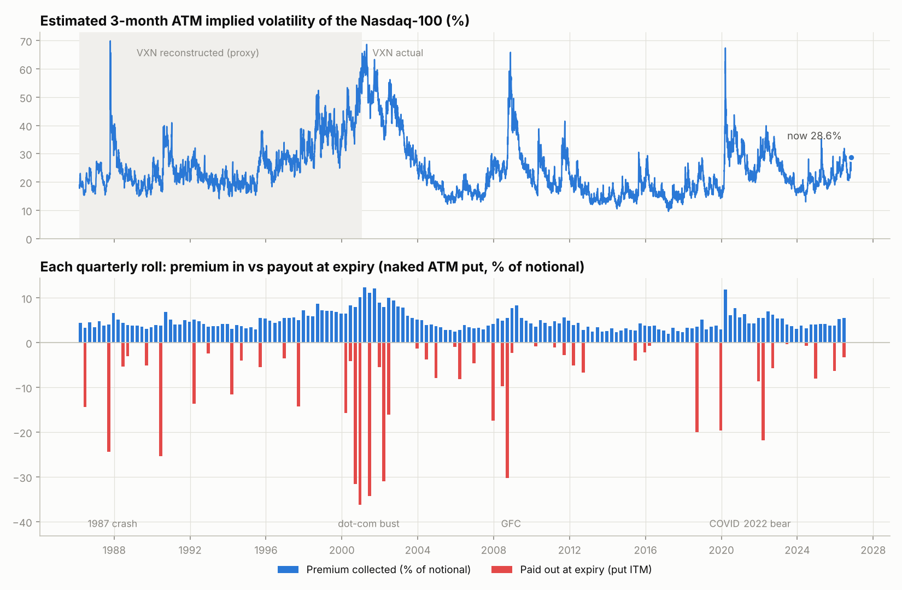
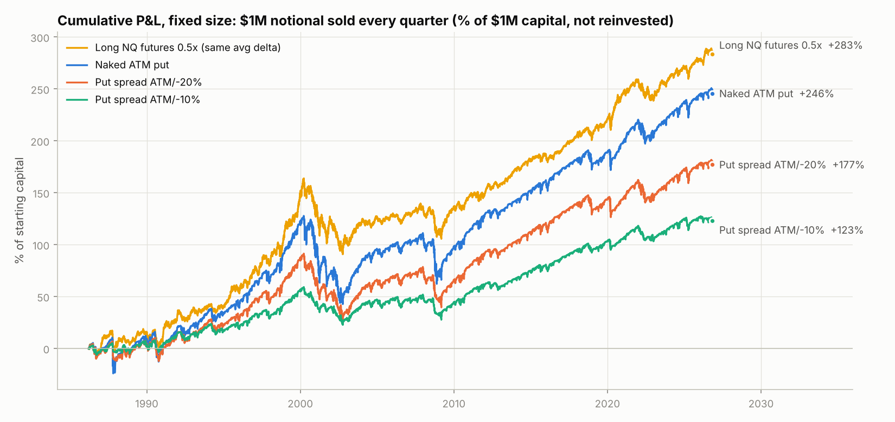
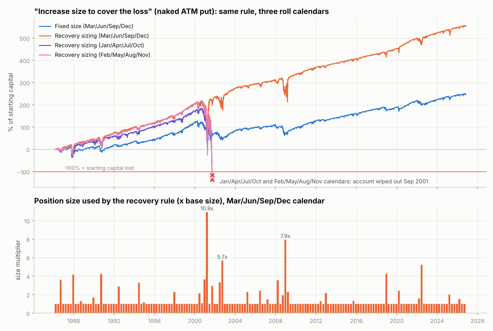
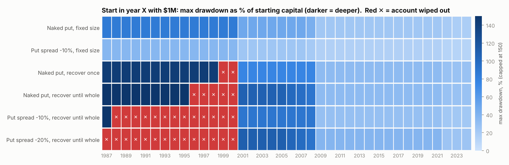
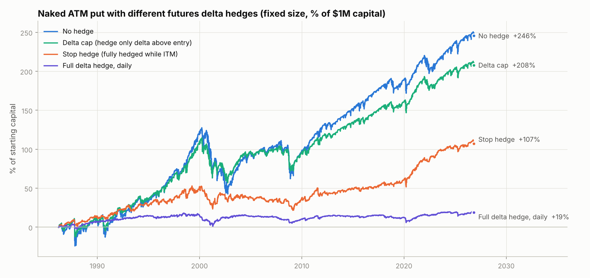
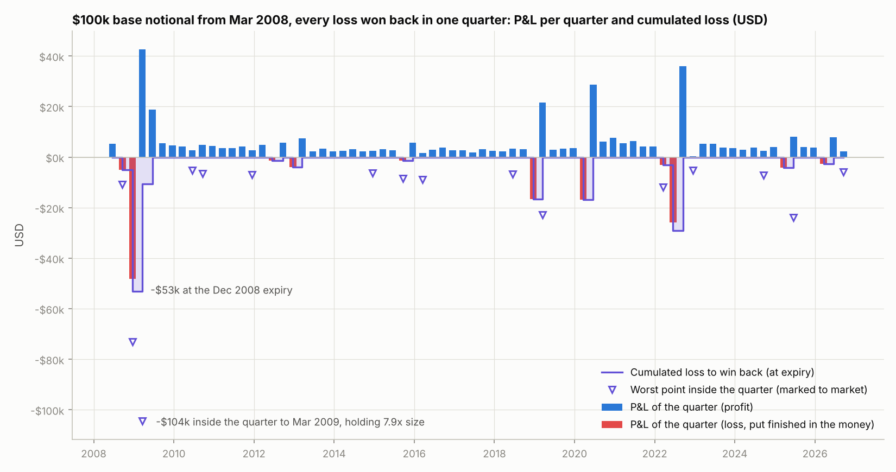
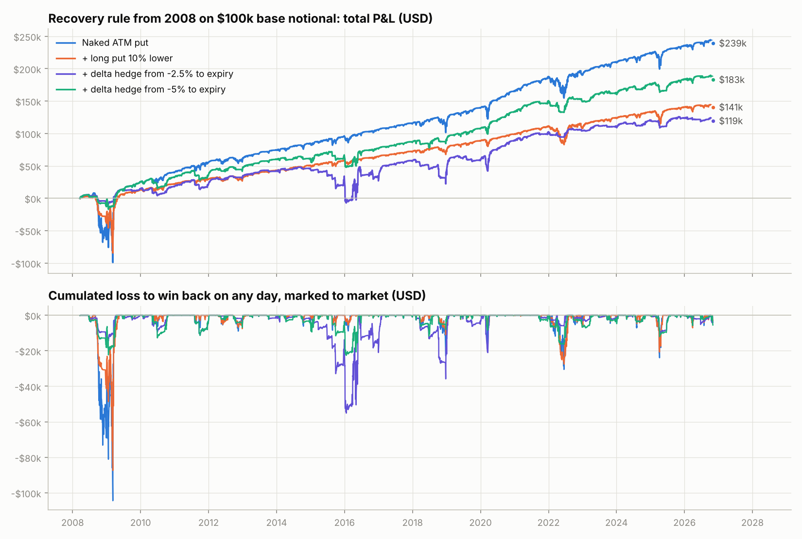

# Selling 3-month ATM puts on Nasdaq-100 futures (NQ): backtest 1986-2026

*Data through 2026-11-02. 162 settled quarterly rolls, 1986-03-21 to 2026-09-18. All option prices are **model estimates** (free historical NQ option quotes do not exist). See [Method](#1-what-was-tested) and [Limitations](#10-limitations).*

## TL;DR: what to take from this

1. **Premiums.** A 3-month ATM put on NQ paid on average **4.8% of notional** (median 4.2%, range 2.0% in 2017 to 12.4% in 2001). At today's index that is about **$26,915 per NQ contract**. Right now (VXN 30.9) the estimate is **5.6%, about $31,840 per NQ**, richer than the long-run average.
2. **Plain strategy** (sell one ATM put per $1 of notional every quarter, hold to expiry): **+6.1%/yr** on notional, 81% winning quarters. But the losses are big: worst quarter -26%, max drawdown **85% of notional** (2000-02). Sharpe 0.41, while simply holding 0.5x NQ futures (the put's average delta) had Sharpe 0.55. Almost all of the put's profit is Nasdaq beta. The volatility premium in ATM NDX options is thin: 3-month ATM implied vol was on average only 1.1 vol pts (median 2.6) above the realized vol that followed.
3. **Increasing size after an ITM loss to win it back is a martingale, and it is the main risk in the plan.** On the Mar/Jun/Sep/Dec calendar it lifted returns to 13.7%/yr. To do that it needed up to **11x size** and suffered a -95% quarter (drawdown 212% of capital). It survived 2000-02 only because the ~11x position sold in March 2001 happened to expire out of the money. The *same rule* on the Jan/Apr/Jul/Oct or Feb/May/Aug/Nov calendars **wiped out the account in 2001**. By start year it was wiped out in 5/38 start years (naked) and in 13/38 and 14/38 start years with -10%/-20% put spreads. For the naked put, every softened version (max 3x, recover once, recover over 4 quarters, 200-day trend filter) still lost more than 100% of starting capital at its worst point on at least one calendar. The mildest version, 'recover once' on a -10% put spread, stayed below that but deepened drawdowns from 36-53% to 51-85% for little or no Sharpe gain. **Don't upsize after losses.**
4. **Buying an OTM put (put spread)** is a risk dial, not an edge. With a -10% wing the worst quarter is -8% (vs -26%) and the max drawdown 36% (vs 85%), but the return halves to 3.1%/yr; Sharpe 0.42 vs 0.41. Put spreads make the martingale *worse*: the net credit is smaller, so 'recovering' needs larger multipliers.
5. **Delta hedging.** A full daily futures hedge strips out the equity premium and leaves only the thin vol premium: +0.5%/yr. That figure is fragile: it ranges from -1.4% to +2.4%/yr if true implied vol was 10% lower or higher than estimated. The one hedge that helped on every calendar is a **delta cap**: short futures only for the delta the put gains *above its entry delta* as NQ falls. It returned 5.2%/yr at Sharpe 0.50 (vs 0.41) with max drawdown 58% (vs 85%).
6. **How to get your 'recovery' without a martingale.** After a losing quarter implied vol is higher, so the *same size* already collects more: on average 6.2% of notional vs 4.5% after a win, and the next quarter averaged +2.4% vs +1.3%. Size for survival instead: the naked put lost 85% of its notional in 2000-02, so naked notional of about 0.3-0.5x equity would have cost 26-43% of the account in that scenario. Cap the tail with a -15% to -20% wing or a delta cap. Ladder entries monthly (1/3 of the size per cycle) so results do not hinge on one roll date.
7. **Today (2026-11-02).** The 3-month put sold 2026-09-18 (strike ~29,888, premium ~1,206 pts = $24,112/NQ) is **in the money**. NQ is about 28,106, the put is worth ~2,190 pts, and the mark-to-market P&L is ~-1,014 pts (-$20,281 per NQ). It has 46 days left and delta ~0.72. Under your rule, a loss at the 18-Dec expiry would trigger a bigger position. The backtest says roll at normal size, because today's rich premium already does part of the recovery.

8. **From 2008, winning back every loss in one quarter (section 9).** On $100k of base notional, not reinvested: a normal quarter that expires OTM pays about $4,216; total P&L $242,680 (fixed size: $151,765). The worst cumulated loss was -$53,140 at an expiry and -$104,425 inside a quarter, holding up to 7.9x size ($793,846 of notional).

## 1. What was tested

* **Trade.** At the close of each quarterly NQ expiry (3rd Friday of Mar/Jun/Sep/Dec), sell the put that expires at the next quarterly expiry (~13 weeks) with the **strike at the futures price (ATM-forward)**. Hold it to expiry. Settlement uses the NDX close on expiry day. 1 NQ option = $20 x index.
* **Size.** Base position = $1,000,000 notional (= 1.0x a $1M account; ~1.8 NQ at today's level). Sizes are fractional. Profits are not reinvested, so every quarter of 40 years counts equally. Returns, drawdowns and quarters are all in % of the $1M starting capital (= base notional).
* **Pricing.** Black-76 on the NQ future, with F = NDX x exp((r - q)T), T-bill r and q = 0.7%. Implied vol is estimated as:
  1. 30-day level = **VXN** (actual since 2001-01-23). Before that VXN is reconstructed from VIX (or VXO before 1990) and the NDX/SPX realized-vol ratio: regression R² 0.95.
  2. ATM vol = -2.30 + 0.982 x VXN. VXN is a variance-swap-style index that includes skew, so it sits above ATM. This line is calibrated on Nasdaq's **VOLQ** at-the-money NDX vol index (2019-09-30..2023-09-28, mean ATM/VXN = 0.89).
  3. 3-month ATM vol = 30-day ATM vol x **VIX3M/VIX** term-structure ratio (regression proxy before 2006, R² 0.68).
  4. Put skew: sigma(K) = sigma_ATM + 0.22/sqrt(T) x ln(F/K). For 3 months that is about +4.6 vol pts at a 10% OTM strike, and the 25-delta risk reversal is about -4.5 vols, typical for NDX.
* **Costs.** Options trade 0.5 vol pt worse than model mid (about 2-3% of the ATM premium), plus $2.50 per contract. Futures hedges cost 1 bp of notional per side. Daily mark-to-market at model mid.
* **Margin and ruin.** Margin is assumed at 10% of notional for a naked put, or the max loss for a spread. A position is cut back if equity cannot carry it. 'Wiped out' means account equity reached zero.
* **Recovery sizing (your rule).** Next size = 1 + (drawdown from equity high) / (premium per $1 of notional). If the new put expires worthless it repays the whole deficit and still earns the normal premium (the 'earn a bit'). Variants tested: *recover once* (only one upsized quarter after a base-size loss), *max 3x*, *recover over 4 quarters*, and *+ 200-day trend filter* (stand aside when NDX < 200-day average).
* **Hedges.** Full delta hedge daily or weekly, 50% hedge, *delta cap* (short futures only for delta above the entry delta), and *stop hedge* (fully delta-hedged only while the put is ITM).

## 2. Premium history



| Decade | Rolls | Avg 3M ATM IV % | Avg premium % of notional | Avg premium $ per NQ | Share expired ITM | Avg naked P&L % per qtr |
|---|---|---|---|---|---|---|
| 1980s | 16 | 21.0 | 4.12 | $149 | 38% | +0.68 |
| 1990s | 40 | 25.4 | 5.01 | $908 | 20% | +2.88 |
| 2000s | 40 | 30.3 | 5.99 | $2,097 | 45% | -0.64 |
| 2010s | 40 | 17.4 | 3.47 | $2,926 | 25% | +1.79 |
| 2020s | 26 | 26.1 | 5.17 | $16,132 | 31% | +2.96 |

Over all rolls: 31% expired ITM, but only 19% lost money, because the premium absorbs small dips. Average winning quarter **+4.3%**, average losing quarter **-10.2%** of notional. One loss wipes out about 2.4 wins, which is why the win rate looks great while the equity curve does not.

**Worst quarters** (% of notional):

| Sold | Expiry | IV % | Premium % | NDX move % | Naked P&L % | Spread -10% P&L % | Spread -20% P&L % |
|---|---|---|---|---|---|---|---|
| 2000-12-15 | 2001-03-16 | 51.55 | 10.09 | -35.38 | -26.21 | -6.34 | -13.74 |
| 2008-09-19 | 2008-12-19 | 27.45 | 5.45 | -30.25 | -24.95 | -7.06 | -15.64 |
| 2000-09-15 | 2000-12-15 | 40.76 | 7.99 | -30.65 | -23.67 | -6.61 | -14.47 |
| 2001-06-15 | 2001-09-21 | 54.29 | 11.08 | -33.77 | -23.28 | -6.23 | -13.43 |
| 2002-03-15 | 2002-06-21 | 38.75 | 7.96 | -30.75 | -23.11 | -6.61 | -14.47 |
| 1990-06-15 | 1990-09-21 | 18.69 | 3.78 | -23.91 | -21.70 | -7.65 | -16.80 |
| 1987-09-18 | 1987-12-18 | 20.67 | 4.05 | -23.27 | -20.46 | -7.57 | -16.62 |
| 2019-12-20 | 2020-03-20 | 14.56 | 2.89 | -19.41 | -16.79 | -7.89 | -16.95 |

Per-year detail (expiry year; premium $ per NQ is at that year's index level): [`results/premiums_by_year.csv`](../results/premiums_by_year.csv). Every roll: [`results/premiums_quarterly.csv`](../results/premiums_quarterly.csv).

| Year | Rolls | Avg IV % | Avg premium % | Avg premium $/NQ | Expired ITM | Naked P&L % (year) | NDX move % |
|---|---|---|---|---|---|---|---|
| 2015 | 4 | 16.46 | 3.28 | $2,869 | 1 | 8.67 | 5.45 |
| 2016 | 4 | 17.96 | 3.57 | $3,221 | 2 | 10.98 | 8.86 |
| 2017 | 4 | 13.26 | 2.63 | $2,902 | 0 | 10.13 | 31.57 |
| 2018 | 4 | 15.51 | 3.10 | $4,431 | 1 | -7.99 | -6.49 |
| 2019 | 4 | 19.67 | 3.87 | $5,522 | 0 | 15.08 | 43.54 |
| 2020 | 4 | 36.12 | 7.18 | $12,722 | 1 | 8.72 | 46.78 |
| 2021 | 4 | 25.92 | 5.16 | $14,012 | 0 | 20.24 | 24.04 |
| 2022 | 4 | 30.53 | 6.06 | $15,981 | 3 | -12.36 | -28.84 |
| 2023 | 4 | 23.55 | 4.63 | $12,399 | 1 | 17.82 | 47.86 |
| 2024 | 4 | 17.98 | 3.57 | $13,390 | 1 | 13.22 | 28.08 |
| 2025 | 4 | 20.60 | 4.06 | $17,816 | 1 | 7.82 | 19.05 |
| 2026 | 3 | 24.83 | 4.90 | $26,389 | 2 | 4.79 | 16.95 |

## 3. Results at fixed size



| Structure | Return %/yr | Vol %/yr | Sharpe | Max DD % cap. | Worst qtr % | Qtrs up % |
|---|---|---|---|---|---|---|
| Naked ATM put | 6.1 | 14.9 | 0.41 | 85 | -26.2 | 81 |
| Put spread ATM/-5% | 1.3 | 4.3 | 0.30 | 22 | -3.7 | 74 |
| Put spread ATM/-10% | 3.1 | 7.3 | 0.42 | 36 | -7.9 | 76 |
| Put spread ATM/-15% | 4.0 | 9.5 | 0.42 | 53 | -12.5 | 78 |
| Put spread ATM/-20% | 4.4 | 11.1 | 0.40 | 65 | -17.0 | 80 |
| Long NQ futures 1x | 14.1 | 25.6 | 0.55 | 146 | -36.2 | 69 |

*Long NQ futures 1x is shown at full notional. At 0.5x (roughly the put's average delta) it returns 7.1%/yr at the same Sharpe 0.55 with max drawdown 73%.*

Since 2001 (actual VXN only):

| Structure | Return %/yr | Sharpe | Max DD % cap. | Worst qtr % |
|---|---|---|---|---|
| Naked ATM put | 7.0 | 0.49 | 49 | -25.0 |
| Put spread ATM/-5% | 1.5 | 0.34 | 12 | -3.7 |
| Put spread ATM/-10% | 3.4 | 0.45 | 24 | -7.9 |
| Put spread ATM/-15% | 4.6 | 0.46 | 33 | -12.5 |
| Put spread ATM/-20% | 5.0 | 0.44 | 39 | -17.0 |
| Long NQ futures 1x | 13.3 | 0.54 | 76 | -34.3 |

## 4. Recovery sizing: "next 3 months increase size to cover the loss"



Same rule on the three possible 3-month roll calendars (return %/yr and max drawdown as % of starting capital):

| Structure · sizing | Mar/Jun/Sep/Dec | Jan/Apr/Jul/Oct | Feb/May/Aug/Nov |
|---|---|---|---|
| Naked ATM put · Fixed 1x | +6.1%/yr, DD 85% | +6.4%/yr, DD 76% | +7.6%/yr, DD 73% |
| Naked ATM put · Recover until whole | +13.7%/yr, DD 212% | **wiped out 2001-09** | **wiped out 2001-09** |
| Naked ATM put · Recover once | +8.0%/yr, DD 143% | +8.7%/yr, DD 83% | +10.3%/yr, DD 121% |
| Naked ATM put · Recover, max 3x | +10.3%/yr, DD 196% | +10.3%/yr, DD 187% | +11.4%/yr, DD 161% |
| Naked ATM put · Recover over 4 quarters | +8.6%/yr, DD 148% | +8.2%/yr, DD 154% | +9.6%/yr, DD 126% |
| Naked ATM put · Fixed + 200d trend filter | +5.2%/yr, DD 37% | +5.4%/yr, DD 33% | +4.8%/yr, DD 55% |
| Naked ATM put · Recover + 200d trend filter | +9.2%/yr, DD 39% | +8.5%/yr, DD 83% | +9.2%/yr, DD 159% |
| Spread -10% · Fixed 1x | +3.1%/yr, DD 36% | +1.6%/yr, DD 53% | +3.2%/yr, DD 49% |
| Spread -10% · Recover until whole | +7.5%/yr, DD 159% | **wiped out 2001-07** | **wiped out 2008-02** |
| Spread -10% · Recover once | +5.0%/yr, DD 51% | +2.1%/yr, DD 78% | +3.8%/yr, DD 85% |
| Spread -10% · Recover, max 3x | +5.2%/yr, DD 95% | +3.8%/yr, DD 129% | +5.3%/yr, DD 118% |
| Spread -10% · Recover over 4 quarters | +4.5%/yr, DD 87% | **wiped out 2006-07** | +4.7%/yr, DD 169% |
| Spread -10% · Fixed + 200d trend filter | +2.3%/yr, DD 16% | +1.6%/yr, DD 33% | +2.5%/yr, DD 20% |
| Spread -10% · Recover + 200d trend filter | +5.3%/yr, DD 24% | **wiped out 1998-10** | +5.5%/yr, DD 76% |



Why it fails: losses cluster. In the 2000-02 bust 6 of 11 quarterly puts lost money. Each loss raises the next size by (loss / next premium). A -25% quarter followed by a 5% premium means 6x size, and a second loss at 6x costs 150% of base notional. So two or three losses in a row compound to 10-30x size, right when volatility and gap risk are highest. Richer premiums after losses do not offset this. The rule turns a once-a-decade drawdown into an account-ending one, and survival depends on which month you happen to roll in.

## 5. Buying the OTM put

| Structure | Sizing | Return %/yr | Vol %/yr | Sharpe | Max DD % cap. | Worst qtr % | Qtrs up % | Max size x | Wiped out |
|---|---|---|---|---|---|---|---|---|---|
| Naked ATM put | Fixed 1x | 6.1 | 14.9 | 0.41 | 85 | -26.2 | 81 | 1.0 | no |
| Naked ATM put | Recover until whole | 13.7 | 35.1 | 0.39 | 212 | -95.3 | 81 | 10.9 | no |
| Naked ATM put | Recover once | 8.0 | 23.2 | 0.34 | 143 | -88.3 | 81 | 4.3 | no |
| Put spread ATM/-5% | Fixed 1x | 1.3 | 4.3 | 0.30 | 22 | -3.7 | 74 | 1.0 | no |
| Put spread ATM/-5% | Recover until whole | -4.4 | 24.8 | -0.18 | 166 | -82.0 | 70 | 29.9 | 2008-09-19 |
| Put spread ATM/-5% | Recover once | 2.6 | 6.7 | 0.39 | 36 | -10.3 | 74 | 3.8 | no |
| Put spread ATM/-10% | Fixed 1x | 3.1 | 7.3 | 0.42 | 36 | -7.9 | 76 | 1.0 | no |
| Put spread ATM/-10% | Recover until whole | 7.5 | 23.9 | 0.31 | 159 | -63.5 | 76 | 19.5 | no |
| Put spread ATM/-10% | Recover once | 5.0 | 10.7 | 0.47 | 51 | -23.8 | 76 | 4.2 | no |
| Put spread ATM/-15% | Fixed 1x | 4.0 | 9.5 | 0.42 | 53 | -12.5 | 78 | 1.0 | no |
| Put spread ATM/-15% | Recover until whole | -6.2 | 49.1 | -0.13 | 252 | -123.7 | 74 | 13.0 | 2002-06-06 |
| Put spread ATM/-15% | Recover once | 6.6 | 13.7 | 0.48 | 70 | -30.1 | 78 | 4.7 | no |
| Put spread ATM/-20% | Fixed 1x | 4.4 | 11.1 | 0.40 | 65 | -17.0 | 80 | 1.0 | no |
| Put spread ATM/-20% | Recover until whole | -6.2 | 56.9 | -0.11 | 275 | -124.9 | 76 | 13.5 | 2002-09-19 |
| Put spread ATM/-20% | Recover once | 6.4 | 16.9 | 0.38 | 105 | -45.5 | 80 | 5.0 | no |
| Long NQ futures 1x | Fixed 1x | 14.1 | 25.6 | 0.55 | 146 | -36.2 | 69 | 1.0 | no |

The wing caps the loss. The naked put's worst quarter was -26%. With -5/-10/-15/-20% wings it is -4% / -8% / -13% / -17%. Return falls about in proportion: Sharpe is 0.30 / 0.42 / 0.42 / 0.40 vs 0.41 naked. Skew makes the protective put relatively expensive (+2 to +10 vol pts over ATM), so the tightest wing (-5%) is the worst deal. Prefer -15% to -20% wings to remove the catastrophe while keeping most of the income.

## 6. Delta hedging



| Hedge | Return %/yr | Vol %/yr | Sharpe | Max DD % cap. | Worst qtr % | Qtrs up % |
|---|---|---|---|---|---|---|
| No hedge | 6.1 | 14.9 | 0.41 | 85 | -26.2 | 81 |
| Delta hedge daily | 0.5 | 2.6 | 0.19 | 17 | -6.7 | 63 |
| Delta hedge weekly | 0.7 | 3.4 | 0.20 | 14 | -9.4 | 63 |
| 50% delta hedge daily | 3.3 | 8.0 | 0.42 | 42 | -14.6 | 81 |
| Delta cap (hedge delta above entry) | 5.2 | 10.5 | 0.50 | 58 | -18.4 | 77 |
| Stop hedge (hedge while ITM) | 2.7 | 5.9 | 0.46 | 31 | -8.7 | 62 |

Sharpe ratio on each roll calendar (robustness):

| Hedge | Mar/Jun/Sep/Dec | Jan/Apr/Jul/Oct | Feb/May/Aug/Nov |
|---|---|---|---|
| No hedge | 0.41 | 0.41 | 0.50 |
| Delta hedge daily | 0.19 | 0.22 | 0.40 |
| Delta hedge weekly | 0.20 | 0.18 | 0.17 |
| 50% delta hedge daily | 0.42 | 0.42 | 0.53 |
| Delta cap (hedge delta above entry) | 0.50 | 0.45 | 0.59 |
| Stop hedge (hedge while ITM) | 0.46 | 0.36 | 0.52 |

* **Full delta hedge**: P&L ≈ ½·Γ·S²·(σ_implied² − σ_realized²). For 3-month NDX ATM options the implied-minus-realized gap averaged +1.1 vol pts (by decade: 1980s +2.5, 1990s +1.8, 2000s -0.7, 2010s +0.0, 2020s +3.8), so after costs very little is left. Hedging *put spreads* is negative because you are long the expensive skew.
* **Delta cap** keeps the original ~0.5 delta exposure (the equity premium is where the money came from) but stops the short put from getting *longer* as the market falls. That is the convexity that hurts in crashes.
* **Stop hedge** (hedge only while ITM) cuts drawdowns but whipsaws: it buys high and sells low around the strike.

## 7. Robustness and sensitivity

Return %/yr (Sharpe) under alternative assumptions:

| Scenario | Naked, fixed | Naked, recover | Spread -10%, fixed | Spread -10%, recover | Naked, delta-hedged, fixed |
|---|---|---|---|---|---|
| Base case | +6.1% (0.41) | +13.7% (0.39) | +3.1% (0.42) | +7.5% (0.31) | +0.5% (0.19) |
| Implied vol -10% | +4.2% (0.28) | +11.6% (0.24) | +2.8% (0.36) | wiped out 2008 | -1.4% (-0.57) |
| Implied vol +10% | +8.1% (0.54) | +15.3% (0.51) | +3.3% (0.47) | +7.7% (0.35) | +2.4% (0.84) |
| Flatter skew (alpha 0.15) | +6.1% (0.41) | +13.7% (0.38) | +3.9% (0.53) | +8.2% (0.39) | +0.6% (0.22) |
| Steeper skew (alpha 0.30) | +6.1% (0.42) | +13.7% (0.40) | +2.1% (0.30) | wiped out 2001 | +0.4% (0.15) |
| Zero trading costs | +6.6% (0.44) | +14.1% (0.41) | +3.9% (0.53) | +8.2% (0.38) | +1.1% (0.41) |
| Double trading costs | +5.7% (0.38) | +13.3% (0.37) | +2.3% (0.31) | wiped out 2002 | -0.1% (-0.03) |
| Cycle Jan/Apr/Jul/Oct | +6.4% (0.41) | wiped out 2001 | +1.6% (0.21) | wiped out 2001 | +0.6% (0.22) |
| Cycle Feb/May/Aug/Nov | +7.6% (0.50) | wiped out 2001 | +3.2% (0.44) | wiped out 2008 | +0.9% (0.40) |
| Only 2001+ (actual VXN) | +7.0% (0.49) | +13.6% (0.46) | +3.4% (0.45) | +7.4% (0.39) | +0.6% (0.26) |
| Only 2009+ (post-GFC) | +9.8% (0.80) | +13.6% (0.89) | +5.2% (0.72) | +8.0% (0.80) | +0.7% (0.33) |

Laddering (1/3 of the size on each monthly cycle) vs single calendars, fixed size, since 1990:

| Structure | Calendar | Return %/yr | Vol %/yr | Sharpe | Max DD % cap. |
|---|---|---|---|---|---|
| Naked ATM put | Mar/Jun/Sep/Dec | 6.5 | 14.9 | 0.44 | 85 |
| Naked ATM put | Jan/Apr/Jul/Oct | 6.8 | 15.6 | 0.43 | 76 |
| Naked ATM put | Feb/May/Aug/Nov | 8.2 | 15.5 | 0.53 | 73 |
| Naked ATM put | Ladder: 1/3 in each cycle | 7.1 | 14.9 | 0.48 | 77 |
| Put spread ATM/-10% | Mar/Jun/Sep/Dec | 3.3 | 7.4 | 0.44 | 36 |
| Put spread ATM/-10% | Jan/Apr/Jul/Oct | 2.0 | 7.7 | 0.26 | 53 |
| Put spread ATM/-10% | Feb/May/Aug/Nov | 3.5 | 7.5 | 0.46 | 49 |
| Put spread ATM/-10% | Ladder: 1/3 in each cycle | 2.9 | 7.0 | 0.41 | 46 |

Takeaways: the *level* of implied vol is the biggest unknown (±10% IV moves the naked put Sharpe from about 0.3 to 0.5 and flips the delta-hedged result's sign). The martingale's fate depends on the calendar and on small modelling choices; the fixed-size results do not.

## 8. Where we are now

As of 2026-11-02: NDX 27,990, VXN 30.9, estimated ATM IV 1M 28.0% / 3M 28.6%.

| Contract (indicative, model) | Days | NQ fut. | ATM IV | ATM put pts | % of notional | $ per NQ | -10% put pts | Spread -10% credit pts |
|---|---|---|---|---|---|---|---|---|
| 3-month (91d) ATM put | 91 | 28,220 | 28.6% | 1,592 | 5.64% | $31,840 | 701 | 891 |
| Dec-2026 quarterly (to 2026-12-18) | 46 | 28,106 | 28.3% | 1,122 | 3.99% | $22,443 | 360 | 762 |
| Mar-2027 quarterly (to 2027-03-19) | 137 | 28,338 | 28.6% | 1,951 | 6.89% | $39,024 | 989 | 962 |

Open backtest position: sold 2026-09-18, strike 29,888, expiry 2026-12-18. It is ITM by 1,782 pts, with model value 2,190 pts vs 1,206 collected.

Check these against live quotes before trading. The model ignores the current skew and term structure of NQ options specifically.

## 9. From 2008: win back every loss in one quarter ($100k base, in dollars)

*Every quarter sells ATM puts on $100,000 of NQ notional, starting with the first 2008 roll (2008-03-20). After a loss the next put is sized so that, if it expires out of the money, its premium repays the whole cumulated loss plus the normal quarter's premium. A campaign starts with a loss and ends when the loss is won back; the next one starts again from $100,000. Profits are not reinvested and nothing limits the size, so the worst cumulated loss is what you must be able to carry.*

* **Normal P&L when the put expires OTM** (premium on $100k): average **$4,216** a quarter, from $1,877 (2017-03-17) to $11,806 (2020-03-20).
* 74 quarters: 53 expired OTM, 10 finished in the money but above breakeven, 11 lost money (-$128,986 in total).
* **Total P&L:** $242,680, about $13,120 a year, not reinvested.
* **Worst cumulated loss:** **-$53,140** at the Dec 2008 expiry. Inside the next quarter (2008-12-19 to 2009-03-20) it reached **-$104,425** marked to market, while the rule held 7.94x size = $793,846 of notional.
* 10 campaigns; every finished one was won back within 4 quarters.
* **Fixed size, no recovery** (same trades at $100k every quarter): $151,765 total, worst cumulated loss -$29,924 (-$40,304 on the worst day).
* **Other roll calendars from 2008:** Jan/Apr/Jul/Oct: worst -$22,869 at expiry, -$67,800 on the worst day, biggest position $335,872; Feb/May/Aug/Nov: worst -$40,370 at expiry, -$49,473 on the worst day, biggest position $624,914.
* **Capital:** holding $793,846 of puts needs margin of roughly $79,385 (10% of notional) on top of the -$104,425 hole: about $183,810 of capital per $100k of base notional.



**Campaigns** (from the first loss until it is won back):

| Campaign started | Quarters | Losing quarters | Worst cumulated loss (expiry) | Worst on any day | Biggest size (x) | Biggest notional | Won back at expiry | P&L of the winning quarter |
|---|---|---|---|---|---|---|---|---|
| 2008-06-20 | 4 | 2 | -$53,140 | -$104,425 | 7.94 | $793,846 | 2009-06-19 | $18,819 |
| 2012-03-16 | 2 | 1 | -$1,300 | -$5,481 | 1.30 | $130,010 | 2012-09-21 | $5,631 |
| 2012-09-21 | 2 | 1 | -$4,014 | -$8,978 | 2.17 | $217,002 | 2013-03-15 | $7,444 |
| 2015-06-19 | 2 | 1 | -$1,406 | -$8,493 | 1.33 | $133,293 | 2015-12-18 | $5,631 |
| 2018-09-21 | 2 | 1 | -$16,587 | -$22,926 | 4.27 | $426,805 | 2019-03-15 | $21,662 |
| 2019-12-20 | 2 | 1 | -$16,790 | -$17,032 | 2.42 | $242,208 | 2020-06-19 | $28,596 |
| 2021-12-17 | 3 | 2 | -$29,033 | -$30,545 | 5.24 | $524,440 | 2022-09-16 | $35,873 |
| 2024-12-20 | 2 | 1 | -$4,071 | -$23,962 | 1.99 | $199,249 | 2025-06-20 | $8,172 |
| 2025-12-19 | 2 | 1 | -$2,646 | -$5,869 | 1.51 | $150,884 | 2026-06-18 | $7,846 |
| 2026-09-18 | 1 | 1 | -$3,393 | -$3,393 | 1.00 | $100,000 | still open |  |

**By year:**

| Year (expiries) | Quarters | OTM quarters | Normal P&L if OTM (avg, $100k) | P&L of OTM quarters | P&L of other quarters | Worst cumulated loss (expiry) | Worst on any day | Biggest notional | Total P&L at year end |
|---|---|---|---|---|---|---|---|---|---|
| 2008 | 3 | 1 | $5,133 | $5,266 | -$53,140 | -$53,140 | -$73,176 | $193,043 | -$47,875 |
| 2009 | 4 | 3 | $6,513 | $28,993 | $42,540 | -$10,600 | -$104,425 | $793,846 | $23,660 |
| 2010 | 4 | 3 | $4,210 | $13,382 | $2,610 | $0 | -$6,492 | $100,000 | $39,651 |
| 2011 | 4 | 2 | $4,464 | $7,731 | $6,238 | $0 | -$7,029 | $100,000 | $53,621 |
| 2012 | 4 | 2 | $3,916 | $10,457 | -$5,314 | -$4,014 | -$8,978 | $130,010 | $58,765 |
| 2013 | 4 | 4 | $2,867 | $15,480 | $0 | $0 | -$6,797 | $217,002 | $74,244 |
| 2014 | 4 | 4 | $2,572 | $10,289 | $0 | $0 | -$6,218 | $100,000 | $84,533 |
| 2015 | 4 | 3 | $3,176 | $11,483 | -$1,406 | -$1,406 | -$8,493 | $133,293 | $94,610 |
| 2016 | 4 | 2 | $3,471 | $6,539 | $4,441 | $0 | -$8,880 | $100,000 | $105,591 |
| 2017 | 4 | 4 | $2,533 | $10,131 | $0 | $0 | -$1,666 | $100,000 | $115,722 |
| 2018 | 4 | 3 | $3,001 | $8,592 | -$16,587 | -$16,587 | -$17,001 | $100,000 | $107,727 |
| 2019 | 4 | 4 | $3,769 | $31,664 | $0 | $0 | -$22,926 | $426,805 | $139,391 |
| 2020 | 4 | 3 | $7,075 | $42,303 | -$16,790 | -$16,790 | -$17,032 | $242,208 | $164,904 |
| 2021 | 4 | 4 | $5,060 | $20,239 | $0 | $0 | -$3,412 | $100,000 | $185,143 |
| 2022 | 4 | 1 | $5,956 | $35,873 | -$28,696 | -$29,033 | -$30,545 | $524,440 | $192,319 |
| 2023 | 4 | 3 | $4,534 | $14,133 | $3,692 | $0 | -$4,582 | $100,000 | $210,144 |
| 2024 | 4 | 3 | $3,470 | $10,745 | $2,471 | $0 | -$7,154 | $100,000 | $223,360 |
| 2025 | 4 | 3 | $3,960 | $15,958 | -$4,071 | -$4,071 | -$23,962 | $199,249 | $235,248 |
| 2026 | 3 | 1 | $4,799 | $7,846 | -$414 | -$2,646 | -$5,869 | $150,884 | $242,680 |

**Every quarter:**

| Sold | Expires | Normal P&L if OTM ($100k) | Size (x) | Notional | Premium | Outcome | P&L | Cumulated loss (expiry) | Worst inside quarter | Total P&L |
|---|---|---|---|---|---|---|---|---|---|---|
| 2008-03-20 | 2008-06-20 | $5,266 | 1.00 | $100,000 | $5,266 | expired OTM | $5,266 | $0 | -$107 | $5,266 |
| 2008-06-20 | 2008-09-19 | $4,789 | 1.00 | $100,000 | $4,789 | ITM, loss | -$4,973 | -$4,973 | -$10,799 | $293 |
| 2008-09-19 | 2008-12-19 | $5,345 | 1.93 | $193,043 | $10,318 | ITM, loss | -$48,167 | -$53,140 | -$73,176 | -$47,875 |
| 2008-12-19 | 2009-03-20 | $7,659 | 7.94 | $793,846 | $60,799 | ITM, still a profit | $42,540 | -$10,600 | -$104,425 | -$5,334 |
| 2009-03-20 | 2009-06-19 | $8,220 | 2.29 | $228,957 | $18,819 | expired OTM | $18,819 | $0 | -$10,851 | $13,485 |
| 2009-06-19 | 2009-09-18 | $5,439 | 1.00 | $100,000 | $5,439 | expired OTM | $5,439 | $0 | -$2,041 | $18,925 |
| 2009-09-18 | 2009-12-18 | $4,735 | 1.00 | $100,000 | $4,735 | expired OTM | $4,735 | $0 | -$1,864 | $23,660 |
| 2009-12-18 | 2010-03-19 | $4,187 | 1.00 | $100,000 | $4,187 | expired OTM | $4,187 | $0 | -$1,189 | $27,847 |
| 2010-03-19 | 2010-06-18 | $3,457 | 1.00 | $100,000 | $3,457 | ITM, still a profit | $2,610 | $0 | -$5,144 | $30,457 |
| 2010-06-18 | 2010-09-17 | $4,863 | 1.00 | $100,000 | $4,863 | expired OTM | $4,863 | $0 | -$6,492 | $35,320 |
| 2010-09-17 | 2010-12-17 | $4,332 | 1.00 | $100,000 | $4,332 | expired OTM | $4,332 | $0 | -$106 | $39,651 |
| 2010-12-17 | 2011-03-18 | $3,573 | 1.00 | $100,000 | $3,573 | expired OTM | $3,573 | $0 | -$105 | $43,224 |
| 2011-03-18 | 2011-06-17 | $4,618 | 1.00 | $100,000 | $4,618 | ITM, still a profit | $3,507 | $0 | -$105 | $46,732 |
| 2011-06-17 | 2011-09-16 | $4,158 | 1.00 | $100,000 | $4,158 | expired OTM | $4,158 | $0 | -$4,242 | $50,890 |
| 2011-09-16 | 2011-12-16 | $5,509 | 1.00 | $100,000 | $5,509 | ITM, still a profit | $2,731 | $0 | -$7,029 | $53,621 |
| 2011-12-16 | 2012-03-16 | $4,826 | 1.00 | $100,000 | $4,826 | expired OTM | $4,826 | $0 | -$449 | $58,447 |
| 2012-03-16 | 2012-06-15 | $3,774 | 1.00 | $100,000 | $3,774 | ITM, loss | -$1,300 | -$1,300 | -$5,481 | $57,147 |
| 2012-06-15 | 2012-09-21 | $4,331 | 1.30 | $130,010 | $5,631 | expired OTM | $5,631 | $0 | -$1,875 | $62,778 |
| 2012-09-21 | 2012-12-21 | $2,732 | 1.00 | $100,000 | $2,732 | ITM, loss | -$4,014 | -$4,014 | -$8,978 | $58,765 |
| 2012-12-21 | 2013-03-15 | $3,431 | 2.17 | $217,002 | $7,444 | expired OTM | $7,444 | $0 | -$6,797 | $66,209 |
| 2013-03-15 | 2013-06-21 | $2,373 | 1.00 | $100,000 | $2,373 | expired OTM | $2,373 | $0 | -$1,324 | $68,582 |
| 2013-06-21 | 2013-09-20 | $3,343 | 1.00 | $100,000 | $3,343 | expired OTM | $3,343 | $0 | -$595 | $71,924 |
| 2013-09-20 | 2013-12-20 | $2,320 | 1.00 | $100,000 | $2,320 | expired OTM | $2,320 | $0 | -$2,256 | $74,244 |
| 2013-12-20 | 2014-03-21 | $2,478 | 1.00 | $100,000 | $2,478 | expired OTM | $2,478 | $0 | -$1,403 | $76,723 |
| 2014-03-21 | 2014-06-20 | $3,060 | 1.00 | $100,000 | $3,060 | expired OTM | $3,060 | $0 | -$3,621 | $79,783 |
| 2014-06-20 | 2014-09-19 | $2,197 | 1.00 | $100,000 | $2,197 | expired OTM | $2,197 | $0 | -$103 | $81,979 |
| 2014-09-19 | 2014-12-19 | $2,554 | 1.00 | $100,000 | $2,554 | expired OTM | $2,554 | $0 | -$6,218 | $84,533 |
| 2014-12-19 | 2015-03-20 | $3,080 | 1.00 | $100,000 | $3,080 | expired OTM | $3,080 | $0 | -$2,683 | $87,614 |
| 2015-03-20 | 2015-06-19 | $2,772 | 1.00 | $100,000 | $2,772 | expired OTM | $2,772 | $0 | -$2,076 | $90,386 |
| 2015-06-19 | 2015-09-18 | $2,629 | 1.00 | $100,000 | $2,629 | ITM, loss | -$1,406 | -$1,406 | -$8,493 | $88,980 |
| 2015-09-18 | 2015-12-18 | $4,224 | 1.33 | $133,293 | $5,631 | expired OTM | $5,631 | $0 | -$6,011 | $94,610 |
| 2015-12-18 | 2016-03-18 | $3,743 | 1.00 | $100,000 | $3,743 | ITM, still a profit | $1,563 | $0 | -$8,880 | $96,173 |
| 2016-03-18 | 2016-06-17 | $3,603 | 1.00 | $100,000 | $3,603 | ITM, still a profit | $2,878 | $0 | -$102 | $99,052 |
| 2016-06-17 | 2016-09-16 | $3,736 | 1.00 | $100,000 | $3,736 | expired OTM | $3,736 | $0 | -$2,345 | $102,788 |
| 2016-09-16 | 2016-12-16 | $2,803 | 1.00 | $100,000 | $2,803 | expired OTM | $2,803 | $0 | -$1,616 | $105,591 |
| 2016-12-16 | 2017-03-17 | $2,607 | 1.00 | $100,000 | $2,607 | expired OTM | $2,607 | $0 | -$872 | $108,198 |
| 2017-03-17 | 2017-06-16 | $1,877 | 1.00 | $100,000 | $1,877 | expired OTM | $1,877 | $0 | -$1,079 | $110,074 |
| 2017-06-16 | 2017-09-15 | $3,226 | 1.00 | $100,000 | $3,226 | expired OTM | $3,226 | $0 | -$845 | $113,301 |
| 2017-09-15 | 2017-12-15 | $2,421 | 1.00 | $100,000 | $2,421 | expired OTM | $2,421 | $0 | -$1,666 | $115,722 |
| 2017-12-15 | 2018-03-16 | $2,278 | 1.00 | $100,000 | $2,278 | expired OTM | $2,278 | $0 | -$2,688 | $118,000 |
| 2018-03-16 | 2018-06-15 | $3,240 | 1.00 | $100,000 | $3,240 | expired OTM | $3,240 | $0 | -$6,786 | $121,240 |
| 2018-06-15 | 2018-09-21 | $3,074 | 1.00 | $100,000 | $3,074 | expired OTM | $3,074 | $0 | -$2,887 | $124,314 |
| 2018-09-21 | 2018-12-21 | $3,413 | 1.00 | $100,000 | $3,413 | ITM, loss | -$16,587 | -$16,587 | -$17,001 | $107,727 |
| 2018-12-21 | 2019-03-15 | $5,075 | 4.27 | $426,805 | $21,662 | expired OTM | $21,662 | $0 | -$22,926 | $129,389 |
| 2019-03-15 | 2019-06-21 | $2,892 | 1.00 | $100,000 | $2,892 | expired OTM | $2,892 | $0 | -$2,205 | $132,281 |
| 2019-06-21 | 2019-09-20 | $3,443 | 1.00 | $100,000 | $3,443 | expired OTM | $3,443 | $0 | -$2,166 | $135,724 |
| 2019-09-20 | 2019-12-20 | $3,667 | 1.00 | $100,000 | $3,667 | expired OTM | $3,667 | $0 | -$2,052 | $139,391 |
| 2019-12-20 | 2020-03-20 | $2,788 | 1.00 | $100,000 | $2,788 | ITM, loss | -$16,790 | -$16,790 | -$17,032 | $122,601 |
| 2020-03-20 | 2020-06-19 | $11,806 | 2.42 | $242,208 | $28,596 | expired OTM | $28,596 | $0 | -$17,032 | $151,197 |
| 2020-06-19 | 2020-09-18 | $6,059 | 1.00 | $100,000 | $6,059 | expired OTM | $6,059 | $0 | -$729 | $157,256 |
| 2020-09-18 | 2020-12-18 | $7,648 | 1.00 | $100,000 | $7,648 | expired OTM | $7,648 | $0 | -$430 | $164,904 |
| 2020-12-18 | 2021-03-19 | $5,495 | 1.00 | $100,000 | $5,495 | expired OTM | $5,495 | $0 | -$132 | $170,399 |
| 2021-03-19 | 2021-06-18 | $6,255 | 1.00 | $100,000 | $6,255 | expired OTM | $6,255 | $0 | -$100 | $176,654 |
| 2021-06-18 | 2021-09-17 | $4,246 | 1.00 | $100,000 | $4,246 | expired OTM | $4,246 | $0 | -$100 | $180,900 |
| 2021-09-17 | 2021-12-17 | $4,243 | 1.00 | $100,000 | $4,243 | expired OTM | $4,243 | $0 | -$3,412 | $185,143 |
| 2021-12-17 | 2022-03-18 | $5,459 | 1.00 | $100,000 | $5,459 | ITM, loss | -$3,135 | -$3,135 | -$11,843 | $182,007 |
| 2022-03-18 | 2022-06-17 | $5,415 | 1.58 | $157,898 | $8,550 | ITM, loss | -$25,897 | -$29,033 | -$30,545 | $156,110 |
| 2022-06-17 | 2022-09-16 | $6,840 | 5.24 | $524,440 | $35,873 | expired OTM | $35,873 | $0 | -$29,557 | $191,983 |
| 2022-09-16 | 2022-12-16 | $6,109 | 1.00 | $100,000 | $6,109 | ITM, still a profit | $336 | $0 | -$5,348 | $192,319 |
| 2022-12-16 | 2023-03-17 | $5,270 | 1.00 | $100,000 | $5,270 | expired OTM | $5,270 | $0 | -$2,491 | $197,589 |
| 2023-03-17 | 2023-06-16 | $5,302 | 1.00 | $100,000 | $5,302 | expired OTM | $5,302 | $0 | -$99 | $202,891 |
| 2023-06-16 | 2023-09-15 | $4,003 | 1.00 | $100,000 | $4,003 | ITM, still a profit | $3,692 | $0 | -$1,205 | $206,583 |
| 2023-09-15 | 2023-12-15 | $3,561 | 1.00 | $100,000 | $3,561 | expired OTM | $3,561 | $0 | -$4,582 | $210,144 |
| 2023-12-15 | 2024-03-15 | $3,017 | 1.00 | $100,000 | $3,017 | expired OTM | $3,017 | $0 | -$1,097 | $213,161 |
| 2024-03-15 | 2024-06-21 | $3,750 | 1.00 | $100,000 | $3,750 | expired OTM | $3,750 | $0 | -$2,259 | $216,911 |
| 2024-06-21 | 2024-09-20 | $3,137 | 1.00 | $100,000 | $3,137 | ITM, still a profit | $2,471 | $0 | -$7,154 | $219,382 |
| 2024-09-20 | 2024-12-20 | $3,978 | 1.00 | $100,000 | $3,978 | expired OTM | $3,978 | $0 | -$99 | $223,360 |
| 2024-12-20 | 2025-03-21 | $3,953 | 1.00 | $100,000 | $3,953 | ITM, loss | -$4,071 | -$4,071 | -$6,453 | $219,290 |
| 2025-03-21 | 2025-06-20 | $4,102 | 1.99 | $199,249 | $8,172 | expired OTM | $8,172 | $0 | -$23,962 | $227,462 |
| 2025-06-20 | 2025-09-19 | $4,093 | 1.00 | $100,000 | $4,093 | expired OTM | $4,093 | $0 | -$99 | $231,555 |
| 2025-09-19 | 2025-12-19 | $3,693 | 1.00 | $100,000 | $3,693 | expired OTM | $3,693 | $0 | -$1,235 | $235,248 |
| 2025-12-19 | 2026-03-20 | $3,732 | 1.00 | $100,000 | $3,732 | ITM, loss | -$2,646 | -$2,646 | -$2,795 | $232,602 |
| 2026-03-20 | 2026-06-18 | $5,200 | 1.51 | $150,884 | $7,846 | expired OTM | $7,846 | $0 | -$5,869 | $240,448 |
| 2026-06-18 | 2026-09-18 | $5,466 | 1.00 | $100,000 | $5,466 | ITM, still a profit | $2,232 | $0 | -$5,824 | $242,680 |
| 2026-09-18 | 2026-12-18 | $3,935 | 1.00 | $100,000 | $3,935 | open (marked to market) | -$3,393 | -$3,393 | -$3,393 | $239,288 |

CSV: [`results/recovery_2008_ledger.csv`](../results/recovery_2008_ledger.csv), [`results/recovery_2008_campaigns.csv`](../results/recovery_2008_campaigns.csv).

### 9.1 Buying the 10% OTM put, and delta hedging after a 2.5% or 5% fall

Same rule, same $100k base and start. Variants: the naked put; the put spread (sell the ATM put, buy the put 10% below it, same expiry); and NQ futures hedges that make the position delta-neutral (rebalanced daily) once NQ is 2.5% or 5% below the strike. *While below* removes the hedge when NQ climbs back above the trigger; *to expiry* keeps it until expiry once triggered. For the spread, the normal P&L is the net credit: the ATM premium minus the cost of the 10% OTM put.

*Premiums are neither fixed nor traded quotes. Each quarter's premium is priced on the sale date with Black-76 from that day's estimated implied volatility (VXN, calibrated to at-the-money levels, plus the VIX3M/VIX term structure), so it moves with the market. The 10% OTM put adds the model's skew (about +4.6 vol points at 3 months). Hedges trade NQ futures at modelled prices from daily Nasdaq-100 closes.*

| Variant (from 2008, Mar/Jun/Sep/Dec) | Normal P&L if OTM | Total P&L | Per year | Worst cumulated loss (expiry) | Worst on any day | Biggest size (x) | Biggest notional | Capital needed | Fixed size: total P&L | Fixed size: worst day |
|---|---|---|---|---|---|---|---|---|---|---|
| Naked ATM put | $4,216 | $242,680 | $13,120 | -$53,140 | -$104,425 | 7.9 | $793,846 | $183,810 | $151,765 | -$40,304 |
| ATM put + long put 10% lower | $2,560 | $143,297 | $7,747 | -$30,756 | -$87,417 | 10.1 | $1,012,083 | $97,836 | $80,925 | -$19,622 |
| Naked + delta hedge below -2.5% | $4,216 | $156,789 | $8,476 | -$26,235 | -$28,573 | 4.2 | $419,174 | $68,612 | $72,721 | -$15,099 |
| Naked + delta hedge below -5% | $4,216 | $196,170 | $10,606 | -$93,927 | -$95,288 | 12.4 | $1,242,711 | $219,560 | $88,257 | -$29,455 |
| Naked + delta hedge from -2.5% to expiry | $4,216 | $121,751 | $6,582 | -$49,858 | -$55,131 | 14.8 | $1,483,758 | $199,751 | $49,224 | -$16,531 |
| Naked + delta hedge from -5% to expiry | $4,216 | $187,442 | $10,134 | -$20,414 | -$22,614 | 6.7 | $666,564 | $87,752 | $96,276 | -$12,934 |
| Spread -10% + delta hedge below -5% | $2,560 | $117,066 | $6,329 | -$41,272 | -$43,925 | 12.9 | $1,294,906 | $126,037 | $57,502 | -$13,967 |



**Worst cumulated loss on any day, every roll calendar, starting 2008 and 1990** (USD, $100k base):

| Variant | 2008 Mar | 2008 Jan | 2008 Feb | 1990 Mar | 1990 Jan | 1990 Feb | Biggest size, any test |
|---|---|---|---|---|---|---|---|
| Naked ATM put | -$104,425 | -$67,800 | -$49,473 | -$204,772 | -$410,524 | -$543,420 | 23x |
| ATM put + long put 10% lower | -$87,417 | -$74,106 | -$47,184 | -$176,579 | -$585,040 | -$521,238 | 146x |
| Naked + delta hedge below -2.5% | -$28,573 | -$62,275 | -$35,603 | -$133,435 | -$208,775 | -$140,682 | 20x |
| Naked + delta hedge below -5% | -$95,288 | -$86,544 | -$40,602 | -$118,339 | -$365,730 | -$361,274 | 38x |
| Naked + delta hedge from -2.5% to expiry | -$55,131 | -$20,639 | -$41,034 | -$121,355 | -$51,575 | -$57,016 | 33x |
| Naked + delta hedge from -5% to expiry | -$22,614 | -$38,322 | -$39,035 | -$57,608 | -$126,241 | -$130,863 | 18x |
| Spread -10% + delta hedge below -5% | -$43,925 | -$192,257 | -$31,747 | -$50,296 | -$378,515 | -$596,502 | 123x |

* **The 10% OTM put does not make the recovery rule safe.** It lowers the normal P&L from $4,216 to $2,560 a quarter, so winning back a loss needs a bigger multiple: up to 10x from 2008 and 146x in the tests from 1990. Worst day from 2008: -$47,184 to -$87,417 across the three calendars (naked -$49,473 to -$104,425). What it does cap is the margin: about $97,836 of capital per $100k instead of $183,810. At fixed size it is a clean risk cut: worst day -$19,622 vs -$40,304.
* **Hedging after the fall and keeping the hedge to expiry worked best.** From -5%: worst day -$22,614 to -$39,035 from 2008 and -$57,608 to -$130,863 from 1990, for $10,134 a year (naked $13,120). From -2.5%: -$20,639 to -$55,131 from 2008 and -$51,575 to -$121,355 from 1990, but only $6,582 a year, because it hedges far more quarters and every hedge loss raises the next recovery size (up to 33x, vs 18x from -5%).
* **Hedges that switch off when NQ bounces back were unstable:** from 2008 the worst day was -$28,573 to -$62,275 (below -2.5%) and -$40,602 to -$95,288 (below -5%), and from 1990 down to -$365,730. In choppy markets (early 2009) the hedge goes on low and comes off high, and each of those losses raises the next recovery size.
* With unlimited sizing, every variant still has a worst case far above its normal quarterly income. Fixed size keeps all the holes small.

### 9.2 Inside "hedge from -5% until expiry"

**How it works.** Nothing happens until NQ closes 5% below the put's strike. That day the position sells NQ futures equal to the put's delta, which makes it delta-neutral. Every day until expiry the hedge is re-sized to the put's delta: if NQ keeps falling, more futures are sold (up to about one future per put when deep in the money); if NQ rises, futures are bought back. The position is never net short. At expiry the futures and the put settle together.

**Did the rebound effect happen? Yes.** Per $100k of notional at fixed size (no recovery sizing), 28 of 74 quarters since 2008 switched the hedge on:

| What NQ did after the trigger | Quarters | Naked put P&L | With the hedge | Hedge effect | Average effect | Worst effect | Best effect |
|---|---|---|---|---|---|---|---|
| hedge never switched on | 46 | $191,461 | $191,461 | $0 | $0 | $0 | $0 |
| fell through the trigger and stayed down | 11 | -$94,533 | -$43,285 | $51,248 | $4,659 | -$3,220 | $18,344 |
| fell through the trigger, recovered part of the way | 7 | $15,560 | -$19,864 | -$35,424 | -$5,061 | -$6,955 | -$3,374 |
| fell through the trigger, then rebounded above the strike | 10 | $39,275 | -$32,037 | -$71,312 | -$7,131 | -$9,640 | -$5,511 |
| all quarters | 74 | $151,763 | $96,275 | -$55,488 | -$750 | -$9,640 | $18,344 |

* In all 10 quarters where NQ fell through -5% and then finished above the strike, the naked put would have kept its whole premium, but the hedged version lost money: the futures sold on the way down were bought back higher on the way up. Cost -$71,312 in total. The strongest rebound was 2025-03-21 to 2025-06-20: NQ fell 13.6% below the strike, then rose 25.7% from the low; the hedge (up to $87,334 of futures) lost -$9,614.
* The damage stays limited because the hedge shrinks as NQ rises: by the time NQ is back above the strike the put's delta is small and so is the short. The loss is the round trip (sell low, buy back high), not an open short position into a rally.
* When NQ kept falling, the hedge paid: $51,248 over 11 quarters, the best $18,344 in a single quarter.
* Net, the hedge cost -$55,488 per $100k since 2008. That is the price of the protection. Every hedged quarter ended between -$8,208 and -$1,142, so the worst quarter improved from -$24,952 to -$8,208.

**Why it looks so good with the recovery rule.** The hedge turns rare big losses into frequent small ones. Small losses need only a modest size increase to win back, so the recovery rule rarely escalates. The trade-off is that about one quarter in three becomes a small loss.

**Overall profitability** (USD, Mar/Jun/Sep/Dec calendar; premiums are net of option trading costs):

| From 2008, $100k base | Premiums kept | Put payouts | Hedge P&L | Hedge trading costs | Total P&L | Worst day | Biggest size |
|---|---|---|---|---|---|---|---|
| Recovery rule | $487,321 | -$220,656 | -$78,347 | -$872 | $187,441 | -$22,614 | 6.7x |
| Fixed size | $311,992 | -$160,224 | -$54,852 | -$637 | $96,275 | -$12,934 | 1.0x |

By year, recovery rule:

| Year | Premiums kept | Put payouts | Hedge P&L | Hedge costs | P&L | Worst day | Biggest size |
|---|---|---|---|---|---|---|---|
| 2008 | $18,197 | -$55,913 | $30,173 | -$53 | -$7,597 | -$13,330 | 1.5x |
| 2009 | $56,056 | -$6,163 | -$18,558 | -$78 | $31,257 | -$22,319 | 3.1x |
| 2010 | $29,211 | -$847 | -$19,773 | -$74 | $8,519 | -$12,762 | 3.0x |
| 2011 | $21,622 | -$5,786 | -$15,659 | -$104 | $71 | -$11,349 | 1.7x |
| 2012 | $24,803 | -$11,820 | -$861 | -$21 | $12,102 | -$8,110 | 2.5x |
| 2013 | $15,531 | $0 | $0 | $0 | $15,531 | -$6,867 | 2.2x |
| 2014 | $12,740 | $0 | -$11,626 | -$54 | $1,060 | -$4,284 | 2.1x |
| 2015 | $21,158 | -$4,035 | -$16,887 | -$64 | $170 | -$11,607 | 2.2x |
| 2016 | $44,825 | -$12,424 | -$16,496 | -$68 | $15,836 | -$22,614 | 6.7x |
| 2017 | $10,131 | $0 | $0 | $0 | $10,131 | -$1,666 | 1.0x |
| 2018 | $16,589 | -$20,000 | $3,730 | -$54 | $266 | -$11,777 | 2.5x |
| 2019 | $20,164 | $0 | $0 | $0 | $20,164 | -$8,060 | 2.0x |
| 2020 | $36,509 | -$19,577 | $8,595 | -$13 | $25,513 | -$8,378 | 1.7x |
| 2021 | $20,239 | $0 | -$6,649 | -$27 | $13,562 | -$3,419 | 1.0x |
| 2022 | $48,686 | -$65,478 | $23,283 | -$101 | $6,390 | -$16,444 | 3.4x |
| 2023 | $26,657 | -$312 | -$17,108 | -$61 | $9,176 | -$7,130 | 2.1x |
| 2024 | $20,231 | -$666 | -$6,088 | -$31 | $13,446 | -$4,782 | 1.9x |
| 2025 | $26,928 | -$8,024 | -$11,070 | -$48 | $7,786 | -$12,047 | 3.3x |
| 2026 | $17,044 | -$9,611 | -$3,353 | -$21 | $4,058 | -$5,869 | 1.5x |

**Does the recovery rule add anything?** Compare it with simply trading a bigger fixed size that has the same worst day:

| Test | Recovery rule: per year | Worst day | Capital needed | Fixed size with the same worst day | Fixed: per year | Fixed: capital needed |
|---|---|---|---|---|---|---|
| from 2008, Mar/Jun/Sep/Dec | $10,134 | -$22,614 | $87,752 | 1.75x | $9,100 | $40,098 |
| from 1990, Mar/Jun/Sep/Dec | $9,305 | -$57,608 | $98,481 | 2.41x | $9,665 | $81,726 |
| from 2008, Jan/Apr/Jul/Oct | $8,970 | -$38,322 | $90,093 | 1.83x | $7,359 | $56,651 |
| from 1990, Jan/Apr/Jul/Oct | $8,807 | -$126,241 | $278,829 | 4.47x | $14,647 | $170,893 |
| from 2008, Feb/May/Aug/Nov | $9,704 | -$39,035 | $104,241 | 2.78x | $14,275 | $66,796 |
| from 1990, Feb/May/Aug/Nov | $8,907 | -$130,863 | $310,413 | 4.40x | $18,638 | $174,855 |

At the same worst-day loss, the bigger fixed size earned more in 4 of 6 tests and always needed less capital. The value is in the hedge; the recovery sizing mostly adds calendar luck.

**Calmar ratio** = average annual P&L / largest peak-to-trough drawdown of the daily marked P&L. Profits are not reinvested, so both are in dollars and the ratio does not depend on account size:

| Variant | Sizing | 2008 Mar | 2008 Jan | 2008 Feb | 1990 Mar | 1990 Jan | 1990 Feb | Median |
|---|---|---|---|---|---|---|---|---|
| Naked ATM put | Recovery rule | 0.12 | 0.18 | 0.27 | 0.07 | 0.03 | 0.03 | 0.09 |
| Naked ATM put | Fixed size | 0.19 | 0.24 | 0.20 | 0.08 | 0.09 | 0.11 | 0.15 |
| Hedge from -5% to expiry | Recovery rule | 0.42 | 0.22 | 0.25 | 0.16 | 0.07 | 0.06 | 0.19 |
| Hedge from -5% to expiry | Fixed size | 0.40 | 0.19 | 0.37 | 0.16 | 0.11 | 0.12 | 0.17 |

From 2008 on the Mar/Jun/Sep/Dec calendar the hedge scores 0.42 with the recovery rule ($10,134 a year over a -$24,193 drawdown) and 0.40 at fixed size. That is the best of the six tests; including the dot-com bust (from 1990) it drops to 0.06-0.16.

### 9.3 Reinvesting after each successful series

Account of $100k, base trade = puts on 1x the account. With reinvesting, every time a quarter ends at a new account high (a losing series fully won back) the base is reset to 1x the new account value; during a losing series it stays fixed. Calmar here is the standard one: compound annual growth (CAGR) divided by the largest drawdown as a % of the account's peak. (Without reinvesting this differs from the dollar Calmar above, which uses the average yearly profit on the starting account.)

| Sizing | Reinvest | End value of $100k (2008) | CAGR (2008) | Max drawdown (2008) | Calmar (2008) | Calmar, median of 6 tests | Worst drawdown, 6 tests |
|---|---|---|---|---|---|---|---|
| Recovery rule | no | $287,315 | 5.9% | 21.3% | 0.28 | 0.14 | 60.8% |
| Recovery rule | yes | $622,000 | 10.4% | 23.8% | 0.44 | 0.20 | 85.4% |
| Fixed size | no | $196,177 | 3.7% | 12.4% | 0.30 | 0.17 | 21.4% |
| Fixed size | yes | $256,653 | 5.2% | 13.0% | 0.40 | 0.17 | 34.0% |

* From 2008 reinvesting lifts Calmar because CAGR rises while the worst drawdown barely changes: that drawdown came in 2008-09, before there was anything to reinvest.
* From 1990 the dot-com crash arrives after ten years of compounding, so the drawdown grows with the account: with the recovery rule the worst drawdown goes from 28.6%-60.8% to 58.3%-85.4%, while Calmar moves only from 0.07-0.14 to 0.09-0.16.
* At fixed size, reinvesting leaves the median Calmar unchanged; the drawdowns grow in proportion to the growth.
* Full grid (leverage 0.5x-2x, naked put too): [`results/reinvest_study.csv`](../results/reinvest_study.csv).

### 9.4 Can it be improved? Calls, extra puts, switching to stocks

Baseline: the -5% hedge kept to expiry, base = 1x a $100k account, reinvesting after each series is won back. Each idea was run with the recovery rule and at fixed size, on all three roll calendars from 2008 and from 1990 (six tests). Calls are sold at the stated % above the futures price, same expiry, and are not hedged; the switch ideas hold long NQ futures (1x the base, optionally with a put 10% below) instead of selling puts until the drawdown is back within half the trigger.

**Fixed size:**

| Idea | Calmar, 2008 | Calmar, median of 6 | CAGR, median of 6 | Worst drawdown | Tests wiped out |
|---|---|---|---|---|---|
| -5% hedge (baseline) | 0.40 | 0.17 | 4.1% | 34% | 0 of 6 |
| + sell call 5% above | 0.00 | 0.02 | 1.0% | 100% | 1 of 6 |
| + sell call 10% above | 0.08 | 0.08 | 3.2% | 100% | 1 of 6 |
| + buy put 15% below | 0.39 | 0.15 | 2.8% | 25% | 0 of 6 |
| + buy put 20% below | 0.39 | 0.19 | 3.4% | 28% | 0 of 6 |
| + sell call 10% above, buy put 20% below | 0.04 | 0.06 | 2.1% | 100% | 1 of 6 |
| after a 40% drawdown: long NQ + put 10% below | 0.40 | 0.17 | 4.1% | 34% | 0 of 6 |
| after a 40% drawdown: long NQ, no put | 0.40 | 0.17 | 4.1% | 34% | 0 of 6 |
| after a 25% drawdown: long NQ + put 10% below | 0.40 | 0.17 | 4.0% | 98% | 0 of 6 |
| NQ 40% below its 52-week high: long NQ + put 10% below | 0.27 | 0.09 | 4.0% | 100% | 2 of 6 |
| NQ 40% below its 52-week high: long NQ, no put | 0.28 | 0.10 | 4.3% | 100% | 2 of 6 |
| NQ 30% below its 52-week high: long NQ + put 10% below | 0.24 | 0.09 | 4.3% | 100% | 2 of 6 |

**Recovery rule:**

| Idea | Calmar, 2008 | Calmar, median of 6 | CAGR, median of 6 | Worst drawdown | Tests wiped out |
|---|---|---|---|---|---|
| -5% hedge (baseline) | 0.44 | 0.20 | 9.3% | 85% | 0 of 6 |
| + sell call 5% above | 0.07 | -0.45 | -47.6% | 100% | 3 of 6 |
| + sell call 10% above | 0.12 | 0.09 | 7.0% | 100% | 2 of 6 |
| + buy put 15% below | 0.36 | 0.15 | 6.8% | 94% | 0 of 6 |
| + buy put 20% below | 0.39 | 0.17 | 7.6% | 95% | 0 of 6 |
| + sell call 10% above, buy put 20% below | 0.08 | 0.08 | 5.9% | 100% | 1 of 6 |
| after a 40% drawdown: long NQ + put 10% below | 0.44 | 0.20 | 9.3% | 100% | 2 of 6 |
| after a 40% drawdown: long NQ, no put | 0.44 | 0.20 | 9.3% | 100% | 2 of 6 |
| after a 25% drawdown: long NQ + put 10% below | 0.44 | 0.16 | 7.8% | 100% | 2 of 6 |
| NQ 40% below its 52-week high: long NQ + put 10% below | 0.40 | 0.16 | 8.7% | 100% | 2 of 6 |
| NQ 40% below its 52-week high: long NQ, no put | 0.41 | -0.36 | -45.3% | 100% | 3 of 6 |
| NQ 30% below its 52-week high: long NQ + put 10% below | 0.34 | 0.15 | 8.4% | 100% | 2 of 6 |

* **Selling calls makes it worse.** The Nasdaq-100 rises too often and too far: in rallies such as 1999 and 2020 the short calls lose, and the recovery rule then upsizes. Median Calmar falls from 0.17 to 0.08 (10% calls, fixed size), and some tests are wiped out.
* **A put 20% below is the only small gain, and only at fixed size:** worst drawdown 34% to 28%, median Calmar 0.17 to 0.19, for less growth (median CAGR 4.1% to 3.4%). With the recovery rule it lowers the premium, so sizes grow and the worst drawdown gets deeper.
* **Switching to stocks after a 40% account drawdown never fires at fixed size** (its worst drawdown is 34%). With the recovery rule it fires only in the 1990 tests, in the middle of the dot-com crash, and the long position wiped out the account in 2001-02.
* **Switching to stocks after the market falls 40% (from its 52-week high)** buys too early in a long bear market: it helped a little after 2008-09 but wiped out two of the three 1990 tests in 2001-02, protective put or not. The -5% hedge is already delta-neutral in a crash; going long re-adds the risk it removed.
* Full results: [`results/improvement_study.csv`](../results/improvement_study.csv).

## 10. Limitations

* Premiums are reconstructed from VXN/VIX, not traded quotes. Error is probably ±10% of premium, and larger before 2001 (VXN proxy) and before 1990 (VXO-based). NQ options did not exist before ~1999-2000; earlier years are a hypothetical on the index.
* Settlement uses the expiry-day close. Real quarterly NQ options settle to the Friday-morning SOQ, and early exercise of American-style quarterlies is ignored.
* The skew is a fixed parametric shape. In real crashes the skew and the term structure move, which matters for spread marks and hedge ratios (but not for expiry payoffs).
* Returns are excess of cash: collateral would also earn T-bill interest (~3% avg). Taxes are ignored.
* Margin is approximate. SPAN margin can jump in a crash, and that is exactly when the martingale needs more of it.

## 11. Reproduce

```bash
pip install -r requirements.txt
python run_backtest.py --refresh   # downloads data, ~30 s
```

Outputs: `results/*.csv` (grid of 200+ strategy variants, premium history, sensitivities), `reports/figures/*.png`, and this report.
